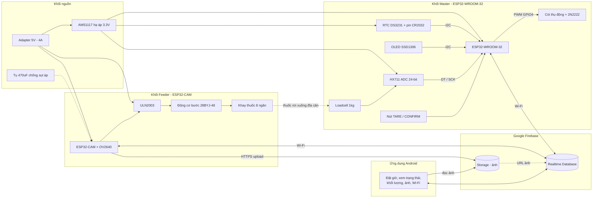
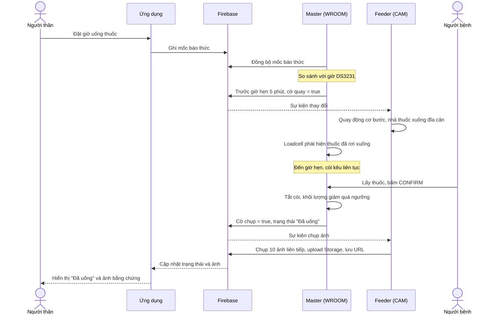
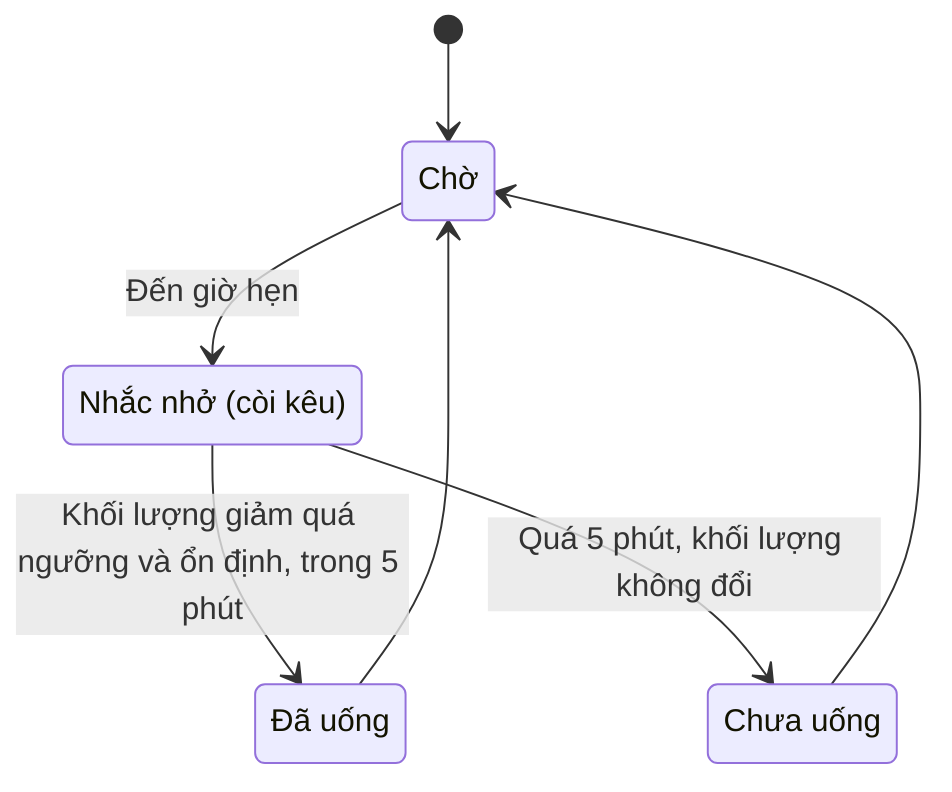

# Tủ thuốc thông minh theo dõi và nhắc nhở hành vi dùng thuốc của người bệnh

> **Smart Medicine Cabinet – Medication Reminder & Behavior Monitoring System**
> Dàn ý đề tài giữa kỳ / Khóa luận tốt nghiệp – ngành Vật lý học

| | |
|---|---|
| **Sinh viên** | Phạm Lê Quốc Thái – MSSV 22000198 |
| **Đơn vị** | Khoa Vật lý, Trường Đại học Khoa học Tự nhiên, ĐHQGHN |
| **Giảng viên hướng dẫn** | ThS. Lương Thị Minh Thúy, ThS. Nguyễn Văn Phú |
| **Từ khóa** | IoT, ESP32, ESP32-CAM, Loadcell + HX711, Stepper 28BYJ-48, Firebase, Android |

---

## 1. Đặt bài toán

### 1.1. Nhu cầu thực tế – nguồn gốc của đề tài

**Dân số Việt Nam đang già đi nhanh.** Theo Tổng cục Thống kê, năm 2024 cả nước có khoảng **14,2 triệu người từ 60 tuổi trở lên**, tăng 2,8 triệu người so với năm 2019 và dự báo xấp xỉ 18 triệu vào năm 2030 ([NSO – Xu hướng già hóa dân số nhanh ở Việt Nam](https://www.nso.gov.vn/du-lieu-va-so-lieu-thong-ke/2025/01/xu-huong-gia-hoa-dan-so-nhanh-o-viet-nam-thuc-trang-va-giai-phap/)). Người cao tuổi thường mắc bệnh mạn tính (tim mạch, tiểu đường, huyết áp…) và phải uống thuốc dài ngày, nhiều loại, nhiều thời điểm trong ngày.

**Quên thuốc, uống sai là vấn đề phổ biến.** WHO ghi nhận ở các nước phát triển, mức tuân thủ điều trị dài hạn của bệnh nhân mạn tính chỉ trung bình khoảng 50% và còn thấp hơn ở các nước đang phát triển ([WHO, 2003 – Adherence to long-term therapies](https://www.who.int/news/item/01-07-2003-failure-to-take-prescribed-medicine-for-chronic-diseases-is-a-massive-world-wide-problem)). Hệ quả là điều trị kém hiệu quả, bệnh chuyển biến xấu, phải nhập viện.

**Con cái bận rộn, sống xa cha mẹ.** Người trẻ đi làm, đi công tác không thể ở bên nhắc cha mẹ uống thuốc. Họ không cần thêm một chiếc báo thức, họ cần biết **cha mẹ đã uống thật hay chưa**.

> Cảm hứng của đề tài: một thiết bị như "quản gia điện tử", đồng thời là món quà để con cái chăm sóc cha mẹ từ xa.

### 1.2. Các giải pháp hiện có và hạn chế

| Giải pháp | Ưu điểm | Hạn chế |
|---|---|---|
| Hộp nhựa chia ngăn (sáng/trưa/chiều/tối, theo thứ) | Rẻ, dễ kiếm | Thụ động, không nhắc, không giám sát được người bệnh có uống hay không |
| Giấy ghi chú, báo thức điện thoại | Miễn phí | Dễ quên, người già khó thao tác, báo thức chỉ nhắc "đến giờ" chứ không kiểm tra "đã uống" |
| Thiết bị nước ngoài (Hero Health, PillDrill…) | Đầy đủ tính năng | Giá cao, giao diện ngoại ngữ, khó bảo hành tại Việt Nam |

### 1.3. Phát biểu bài toán

> Thiết kế và chế tạo một tủ thuốc thông minh **giá rẻ**, có thể (1) **nhắc** đúng giờ, (2) **nhả đúng liều**, (3) **xác nhận bằng phép đo vật lý** việc thuốc đã được lấy đi, (4) **ghi bằng chứng bằng hình ảnh**, và (5) **báo cho người thân từ xa** qua ứng dụng di động.

**Yêu cầu chức năng**

- Báo thức bằng còi, hiển thị trên màn hình OLED, giờ uống thuốc chỉnh từ xa trên ứng dụng.
- Nhả thuốc tự động bằng động cơ bước, mỗi ngăn một liều.
- Cân khối lượng thuốc trên đĩa cân (Loadcell + HX711) để xác định đã lấy thuốc hay chưa.
- Chụp chuỗi ảnh khi người bệnh bấm xác nhận, lưu lên đám mây làm bằng chứng.
- Ứng dụng Android: xem trạng thái "Đã uống / Chưa uống", khối lượng, giờ hẹn, ảnh, cấu hình Wi-Fi.

**Yêu cầu phi chức năng**

- Chi phí thấp, linh kiện phổ biến, mạch in tự gia công được (PCB một lớp, ăn mòn phíp đồng).
- Vẫn đúng giờ khi mất mạng hoặc mất điện đột ngột (RTC DS3231 có pin dự phòng, NVS lưu cấu hình).
- Vận hành ổn định (không treo, không brownout) khi camera, Wi-Fi và động cơ chạy cùng lúc.
- Dễ dùng cho người cao tuổi (OLED tương phản cao, chỉ một nút xác nhận).

---

## 2. Nội dung chính

| Chương | Nội dung |
|---|---|
| **Mở đầu** | Lý do chọn đề tài, mục tiêu, phương pháp, kết cấu |
| **1. Tổng quan** | Thực trạng dùng thuốc, hạn chế của tủ thuốc truyền thống, vai trò của IoT/healthtech, ý nghĩa đề tài |
| **2. Phân tích hệ thống, lựa chọn linh kiện và công nghệ** | Kiến trúc phân tán hai khối; ESP32-WROOM-32 và ESP32-CAM; Loadcell (strain gauge, cầu Wheatstone) + HX711 24-bit; xử lý zero drift, hiệu chuẩn tuyến tính; động cơ bước 28BYJ-48 + ULN2003; Firebase RTDB/Storage, Security Rules |
| **3. Thiết kế và xây dựng** | Sơ đồ nguyên lý khối Master và khối Feeder, tính toán nguồn, PCB một lớp (KiCad); thuật toán điều khiển hai khối; ứng dụng Android |
| **4. Thực nghiệm và đánh giá** | Mô hình in 3D (PLA); hiệu chuẩn khối đo khối lượng; kiểm thử luồng nhắc – nhả – xác nhận – chụp ảnh – đồng bộ |
| **Kết luận và kiến nghị** | Kết quả đạt được; hướng phát triển (Computer Vision, LLM, PCB nhiều lớp SMD, khay nhiều tầng) |

---

## 3. Sơ đồ khối dự kiến

### 3.1. Sơ đồ khối hệ thống

Hệ thống gồm hai khối vi điều khiển độc lập, **không nối dây với nhau**, giao tiếp qua Firebase.



### 3.2. Luồng hoạt động của một lần uống thuốc



### 3.3. Máy trạng thái xác nhận hành vi uống thuốc



### 3.4. Phân bổ chân chính (khối Master)

| Chức năng | Chân ESP32-WROOM-32 |
|---|---|
| I2C: DS3231 + OLED | GPIO21 (SDA), GPIO22 (SCL) |
| HX711 | GPIO25 (DT), GPIO26 (SCK) |
| Còi (qua 2N2222, PWM/LEDC) | GPIO4 |
| Nút TARE, CONFIRM | GPIO với pull-up nội |

Khối Feeder dùng cụm GPIO12–15 của ESP32-CAM điều khiển 4 pha động cơ bước qua ULN2003.

---

## 4. Phương pháp thực hiện

1. **Chọn linh kiện và lên kế hoạch.** Loadcell 1 kg + HX711, ESP32-WROOM-32, ESP32-CAM, 28BYJ-48 + ULN2003, DS3231, OLED, còi.
2. **Kiểm tra từng khối trên breadboard.** Đọc cảm biến, điều khiển động cơ, truyền dữ liệu Firebase.
3. **Thiết kế mạch và phần mềm.** Schematic và PCB trên KiCad, firmware, ứng dụng Android (Android Studio).
4. **Chế tạo mô hình.** Vỏ in 3D FDM bằng nhựa PLA trắng, ba tầng (nguồn + đĩa cân, quan sát camera, khoang thuốc).
5. **Vận hành và hiệu chỉnh.** Chạy theo lịch thực tế, đo sai số khối lượng, tinh chỉnh phần mềm.

---

## 5. Kết quả

- **Khối đo khối lượng:** thử từ 0,5 g đến 5,0 g, bước 0,1 g. Đường hồi quy thực nghiệm `y = 0,04864 + 0,99045x`, **R² = 0,99982**. Ở dải dưới 1,0 g có dao động nhỏ (khoảng 0,1 g), từ 1,0 g trở lên các điểm hội tụ sát đường tuyến tính.
- **Hệ thống phân tán:** hai khối Master/Feeder phối hợp ổn định qua Firebase, không còn brownout nhờ tụ 470 µF và nguồn 5V 4A.
- **Ứng dụng Android:** hiển thị trạng thái "Đã uống / Chưa uống", khối lượng thời gian thực, đặt giờ báo thức dạng đồng hồ, xem ảnh trên Firebase Storage, cấu hình Wi-Fi qua AP mode (192.168.4.1).

---

## 6. Hướng phát triển

- Nhận diện thị giác máy tính (Computer Vision) để xác định người bệnh có thực sự đưa thuốc lên miệng, phát hiện kẹt thuốc.
- Trợ lý AI/LLM trong ứng dụng: giải đáp công dụng, tác dụng phụ, báo cáo xu hướng tuân thủ gửi bác sĩ.
- PCB nhiều lớp dùng linh kiện SMD, vỏ chống ẩm cho khí hậu nóng ẩm.
- Khay dạng ma trận hoặc nhiều tầng cho phác đồ nhiều loại thuốc.

---

## 7. Tài liệu tham khảo (chọn lọc)

1. Tổng cục Thống kê, *Xu hướng già hóa dân số nhanh ở Việt Nam: thực trạng và giải pháp*, 2025. <https://www.nso.gov.vn/du-lieu-va-so-lieu-thong-ke/2025/01/xu-huong-gia-hoa-dan-so-nhanh-o-viet-nam-thuc-trang-va-giai-phap/>
2. WHO, *Adherence to long-term therapies: evidence for action*, 2003. <https://www.who.int/news/item/01-07-2003-failure-to-take-prescribed-medicine-for-chronic-diseases-is-a-massive-world-wide-problem>
3. PillDrill, Inc., 2016. <https://www.pilldrill.com>
4. A. R. Lellapati et al., "Development of advanced alerting system using Arduino interfaced with ESP32 CAM," *IEEE ICCCMLA*, 2022.
5. N. Cameron, "ESP32 microcontroller," in *ESP32 Formats and Communication*, Springer, 2023.
6. Avia Semiconductor, *HX711 – 24-Bit ADC for Weigh Scales*.
7. A. Hughes, B. Drury, *Electric Motors and Drives*, Newnes, 2019.
8. A. M. Yasir et al., "Comparative Performance Analysis of Firebase Realtime Database and Supabase," *ICE3IS*, 2025.

---

## 8. Cấu trúc repo (dự kiến)

```
smart-medicine-cabinet/
├── README.md          # Dàn ý (file này)
├── docs/              # Khóa luận (PDF), hình ảnh, sơ đồ
├── hardware/          # Schematic, PCB KiCad, file in 3D (STL)
├── firmware/
│   ├── master/        # ESP32-WROOM-32
│   └── feeder/        # ESP32-CAM
└── app/               # Android Studio project
```
