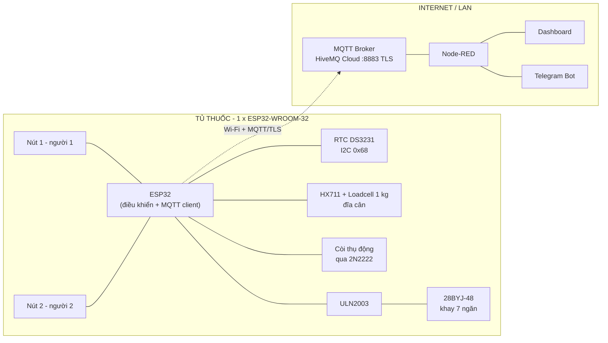
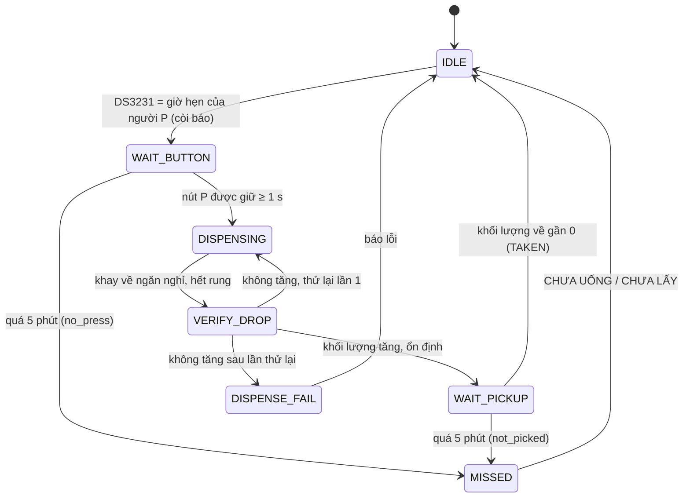
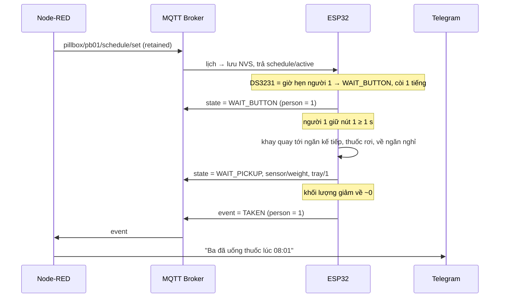
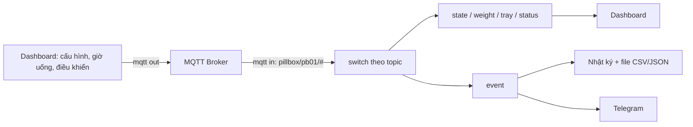

# Tủ thuốc thông minh theo dõi và nhắc nhở hành vi dùng thuốc

> **IoT Apps Dev** · ESP32 · MQTT · Node-RED Dashboard · Telegram Bot · PlatformIO

| | |
|---|---|
| **Sinh viên thực hiện** | Vũ Việt Anh – 23001579 |
| **Giảng viên hướng dẫn** | Nguyễn Anh Tuấn |
| **Vi điều khiển** | 1 × ESP32-WROOM-32 |
| **Cơ cấu chia thuốc** | 1 khay 15 ngăn + 1 động cơ bước 28BYJ-48, dùng chung cho 2 người |
| **Truyền thông** | MQTT/TLS (HiveMQ Cloud) → Node-RED → Dashboard / Telegram |

## Mục lục

1. [Giới thiệu](#1-giới-thiệu)
2. [Đặt vấn đề](#2-đặt-vấn-đề)
3. [Mục tiêu và phạm vi](#3-mục-tiêu-và-phạm-vi)
4. [Kiến trúc hệ thống](#4-kiến-trúc-hệ-thống)
5. [Phần cứng](#5-phần-cứng)
6. [Nguyên lý hoạt động](#6-nguyên-lý-hoạt-động)
7. [Giao tiếp MQTT](#7-giao-tiếp-mqtt)
8. [Dashboard Node-RED và Telegram Bot](#8-dashboard-node-red-và-telegram-bot)
9. [Đóng góp và tính ứng dụng](#9-đóng-góp-và-tính-ứng-dụng)
10. [Công cụ và môi trường phát triển](#10-công-cụ-và-môi-trường-phát-triển)
11. [Kế hoạch thực hiện](#11-kế-hoạch-thực-hiện)
12. [Hình ảnh linh kiện và mô hình](#12-hình-ảnh-linh-kiện-và-mô-hình)
13. [Tài liệu tham khảo](#13-tài-liệu-tham-khảo)

---

## 1. Giới thiệu

Đề tài xây dựng hệ thống IoT trên mô hình tủ thuốc thu nhỏ dùng chung cho **hai người** (ví dụ ông và bà), thực hiện đồng thời ba chức năng:

- **Nhắc giờ uống thuốc:** báo thức bằng còi với mẫu âm riêng cho từng người (thiết bị không có màn hình). Giờ uống được cài từ xa trên Node-RED Dashboard, lưu trong bộ nhớ NVS của ESP32 và chạy theo đồng hồ thời gian thực DS3231 nên mất mạng vẫn báo đúng giờ.
- **Chia thuốc đúng người, đúng liều:** một khay tròn 15 ngăn quay bằng một động cơ bước. Mỗi người có một nút bấm riêng; bấm nút của mình thì khay quay tới đúng ngăn thuốc của người đó và thuốc rơi xuống đĩa cân.
- **Theo dõi hành vi dùng thuốc:** loadcell kiểm tra hai giai đoạn, thuốc đã **rơi** xuống đĩa cân và thuốc đã **được lấy đi**. Kết quả (Đã uống / Chưa uống / Chưa lấy thuốc / Lỗi nhả thuốc) hiển thị theo từng người trên dashboard và gửi cảnh báo cho người thân qua Telegram.

Toàn bộ thiết bị chỉ dùng **một ESP32-WROOM-32**. Dữ liệu được trao đổi qua giao thức MQTT (HiveMQ Cloud, TLS cổng 8883) và được giám sát, điều khiển từ xa bằng Node-RED Dashboard trên máy tính và điện thoại. Việc lưu nhật ký và gửi Telegram do Node-RED đảm nhiệm.

## 2. Đặt vấn đề

**Quên uống thuốc, uống sai thuốc.** Dân số già hóa, người cao tuổi thường mắc bệnh mãn tính và phải dùng thuốc đều đặn mỗi ngày. Việc quên hoặc uống sai thuốc vẫn phổ biến, làm giảm hiệu quả điều trị. Trong khi đó nhiều người trẻ đi làm xa, không thể thường xuyên nhắc cha mẹ uống thuốc đúng giờ, đúng liều [1].

**Giải pháp hiện có còn hạn chế.**

- *Hộp chia ngăn truyền thống:* thụ động, không biết người bệnh đã uống thật hay chưa.
- *Báo thức điện thoại, giấy nhớ:* chỉ nhắc "đến giờ", dễ tắt rồi quên, người lớn tuổi thao tác khó.
- *Tủ thuốc thông minh nhập khẩu (Hero Health, PillDrill…):* giá cao, rào cản ngôn ngữ, khó bảo hành tại Việt Nam.

**Nguy cơ uống nhầm thuốc của nhau.** Trong gia đình thường có hai người dùng hai loại thuốc khác nhau. Hộp chung một ngăn không phân biệt được ai lấy thuốc nào.

**Người thân ở xa không nắm được tình hình.** Dù người bệnh có được nhắc giờ, người thân vẫn không biết thuốc đã được lấy hay chưa, trừ khi gọi điện hỏi.

**Hướng giải quyết.** Dùng cảm biến để thu thập thông tin khách quan về việc nhả thuốc và lấy thuốc, đồng thời **tách vật lý** thuốc của hai người: trên một khay quay, các ngăn được chia thành hai dải riêng, mỗi người một nút gắn cứng với dải ngăn của mình. Nút nào chỉ đưa khay về đúng dải ngăn của người đó nên không thể lấy nhầm. Kết quả được đẩy tới người thân qua MQTT, Node-RED và Telegram, không cần cài thêm ứng dụng riêng.

## 3. Mục tiêu và phạm vi

### Mục tiêu

- Nhắc đúng giờ cho từng người bằng còi với mẫu âm riêng (người 1: 1 tiếng, người 2: 2 tiếng).
- Cho mỗi người bấm nút riêng (giữ ≥ 1 s) để nhận đúng một liều thuốc của mình trong cửa sổ 5 phút kể từ giờ hẹn.
- Xác nhận bằng loadcell hai giai đoạn: thuốc đã rơi và thuốc đã được lấy đi.
- Xác định trạng thái từng người (Chờ, Đã uống, Chưa uống, Chưa lấy thuốc, Lỗi nhả thuốc) và hiển thị trên dashboard.
- Cài giờ uống, tên người, tên thuốc, ngưỡng khối lượng từ xa qua Node-RED; điều khiển TARE, nhả thủ công, tắt còi, đặt lại khay.
- Tự động gửi cảnh báo Telegram cho người thân khi chưa uống, chưa lấy thuốc, lỗi nhả thuốc, sắp hết thuốc hoặc tủ mất kết nối.
- Cấu hình Wi-Fi/MQTT lần đầu qua Access Point của ESP32 (captive portal tại `192.168.4.1`).

### Phạm vi

- Mô hình thu nhỏ gồm **hai khay 7 ngăn** (1 ngăn thuốc rơi + 6 đụng thuốc ), mỗi người một loại thuốc cố định và một lần uống mỗi ngày. Cấu trúc topic MQTT theo `device_id` và `person` cho phép mở rộng.
- Nút bấm là xác nhận chủ động, **không xác thực danh tính**: người khác vẫn có thể bấm nút của người kia trong cửa sổ giờ hẹn. Biện pháp hạn chế xem mục [6.5](#65-bảo-mật-và-giới-hạn-đã-biết).
- Thiết bị không có camera nên chỉ biết thuốc đã được **lấy khỏi đĩa cân**, không xác nhận được người bệnh đã thật sự uống.
- Liều được đếm theo **lần nhả**, không theo ngày lịch: liều của ngày bị bỏ lỡ vẫn nằm trong ngăn và được nhả vào lần sau.
- Viên thuốc nhẹ gần với sai số loadcell (~0,1 g) nên cần hiệu chuẩn lại và đặt ngưỡng `min_g` theo từng loại thuốc.
- Hai giờ hẹn trùng nhau được phục vụ tuần tự; khuyến nghị đặt cách nhau ≥ 10 phút.
- Dashboard chạy trong mạng nội bộ; muốn xem từ xa cần VPN (ví dụ Tailscale) hoặc máy chủ có địa chỉ công khai. Cảnh báo Telegram không cần mở cổng Internet.

## 4. Kiến trúc hệ thống



Firmware chia hai tác vụ FreeRTOS để đo cân và điều khiển không bị ảnh hưởng bởi mạng: tác vụ **điều khiển** (nút, động cơ, cân, lịch) và tác vụ **mạng** (Wi-Fi, MQTT). Động cơ chỉ quay khi không đọc cân, và cân chỉ được đọc sau khi khay đã dừng hẳn.

## 5. Phần cứng

| Linh kiện | Vai trò |
|---|---|
| ESP32-WROOM-32 (DevKit) | Xử lý, lịch, đọc nút/cảm biến, điều khiển động cơ, còi, Wi-Fi, MQTT. Phải dùng WROOM, không dùng WROVER vì GPIO16/17 bị PSRAM chiếm |
| Loadcell 1 kg + module HX711 | Cân khối lượng thuốc, dùng chung cho hai người; HX711 là ADC 24-bit |
| RTC DS3231 + pin CR2032 | Giữ giờ khi mất điện, mất mạng |
| Động cơ bước 28BYJ-48 + driver ULN2003 | Xoay khay thuốc 15 ngăn |
| Còi thụ động 5V + transistor 2N2222 + điện trở Base ~1 kΩ | Báo giờ uống (mẫu âm riêng từng người), báo bấm sai, báo lỗi |
| 2 nút nhấn lớn khác màu (đỏ, xanh dương) | Mỗi người một nút để nhận thuốc |
| Adapter 5V – 2A + jack DC | Nguồn chung; 3,3V lấy từ chân 3V3 của DevKit |
| Tụ hóa 470 µF; tụ gốm 100 nF × 2 (tùy chọn) | Chống sụt áp/brownout; chống dội nút |
| PCB phíp đồng một lớp, header, dây jumper | Một bo duy nhất cho toàn thiết bị |
| Nhựa PLA trắng (in 3D FDM) | Vỏ tủ, khay 15 ngăn, máng dẫn thuốc, đĩa cân |

Chi phí dự kiến: *(cập nhật sau khi chốt danh sách mua)*.

### Bảng chân ESP32

| Ngoại vi | Chân ESP32 | Ghi chú |
|---|---|---|
| RTC DS3231 | SDA = GPIO21, SCL = GPIO22 | I2C, địa chỉ 0x68, cấp 3,3V |
| HX711 | DT = GPIO25, SCK = GPIO26 | Cấp 3,3V để mức logic không vượt 3,3V |
| Còi thụ động (qua 2N2222) | GPIO4 (LEDC PWM) | Cực dương còi nối 5V, cực âm nối Collector; Emitter nối GND |
| Nút 1 – người 1 (đỏ) | GPIO32 | `INPUT_PULLUP`, nhấn = mức 0 |
| Nút 2 – người 2 (xanh dương) | GPIO33 | `INPUT_PULLUP`, nhấn = mức 0 |
| ULN2003 IN1..IN4 | GPIO16, 17, 18, 19 | Với `AccelStepper` (`HALF4WIRE`) khai báo thứ tự IN1, IN3, IN2, IN4 = (16, 18, 17, 19) |

### Khối nguồn

| Thành phần | Dòng điển hình | Dòng đỉnh |
|---|---|---|
| ESP32-WROOM (có Wi-Fi) | 100 mA | 260 mA |
| Động cơ bước 28BYJ-48 | ~240 mA | ~500 mA |
| HX711 + loadcell | 10–15 mA | 10–15 mA |
| Còi 5V qua transistor | 20–30 mA | 20–30 mA |
| DS3231 | < 1 mA | < 1 mA |
| **Tổng** | **~0,4 A** | **~0,8 A** |

Chọn adapter 5V – 2A. Một nguồn 5V chung, nối đất chung cho ESP32, ULN2003 và còi. Firmware cắt dòng cuộn dây (đặt 4 chân IN về 0) ngay khi khay dừng để động cơ không nóng và không gây nhiễu loadcell. Tụ 470 µF đặt sát chân nguồn ESP32 để tránh brownout khi động cơ khởi động cùng lúc với Wi-Fi.

### Quy ước trong mô hình thu nhỏ

- Mỗi ngăn chứa liều của một ngày (một lần uống), do người thân chia sẵn.
- Hai nút khác màu, dán nhãn tên từng người.
- Khi triển khai thực tế có thể bổ sung công tắc hành trình hoặc cảm biến Hall tại ngăn nghỉ để tự căn vị trí khay, và OLED/LED hiển thị trạng thái; phần mềm giữ nguyên.

## 6. Nguyên lý hoạt động

### 6.1. Bố trí khay và cơ cấu chia thuốc

Khay tròn 15 ngăn (mỗi ngăn 24°) đặt trên sàn cố định có **một lỗ rơi**; động cơ bước đặt giữa khay. Khi khay ở **vị trí nghỉ (R)**, ngăn nghỉ (luôn trống) nằm trên lỗ rơi nên không có thuốc nào rơi. Hai người nằm ở hai phía đối nhau của ngăn nghỉ:

```
 [-7][-6][-5][-4][-3][-2][-1][ R ][+1][+2][+3][+4][+5][+6][+7]
 └────────── NGƯỜI 2 ────────┘  ▲   └────────── NGƯỜI 1 ────────┘
                              lỗ rơi (khi khay ở vị trí nghỉ)
```

Người 1 dùng các ngăn +1…+7 (thuận chiều kim đồng hồ), người 2 dùng các ngăn −1…−7 (ngược chiều). Thuốc được dùng từ ngăn gần ngăn nghỉ ra xa (ngày 1 là ngăn ±1, ngày 2 là ngăn ±2…).

**Một lần nhả** (người P ở liều thứ `j`, `j` = 1…7; `dir` = +1 cho người 1, −1 cho người 2):

1. Quay `dir × round(j × SPR / 15)` nửa bước từ vị trí nghỉ. `SPR` là số nửa bước mỗi vòng của khay (28BYJ-48 thực tế ≈ 4076, cần đo thực nghiệm), khoảng 272 nửa bước mỗi ngăn. Trên đường đi khay chỉ ngang qua `j − 1` ngăn đã trống.
2. Dừng ~1 s để viên thuốc của ngăn thứ `j` rơi qua lỗ, theo máng dẫn xuống đĩa cân gắn trên loadcell.
3. Quay ngược lại đúng số bước đó về vị trí nghỉ, cắt dòng cuộn dây, chờ ~0,5 s cho hết rung rồi mới đọc cân.

Mỗi lượt đi–về dùng cùng số bước tuyệt đối và khay luôn dừng ở vị trí nghỉ giữa hai lần nhả nên sai số bước **không tích lũy**. Ngăn của người kia không bao giờ đi qua lỗ rơi nên không thể rơi nhầm thuốc. Nếu mất điện giữa chừng, ESP32 lưu cờ vị trí vào NVS trước khi quay và xóa sau khi về nghỉ; khởi động lại thấy cờ chưa xóa thì tự quay về vị trí nghỉ.

### 6.2. Máy trạng thái



Thời gian chờ bấm nút là **5 phút kể từ giờ hẹn**; thời gian chờ lấy thuốc là **5 phút kể từ lúc thuốc rơi**; cả hai cấu hình được trong lịch. Tại một thời điểm ESP32 chỉ xử lý **một người**.

Bấm nút **ngoài giờ** hoặc khi **đang xử lý cho người kia** không nhả thuốc: còi kêu 3 tiếng ngắn và sự kiện `DENIED` được ghi lại. Mỗi mốc giờ chỉ nhả tối đa một liều (sau khi nhả, nút bị khóa đến mốc kế tiếp).

| Tình huống | Mẫu âm của còi |
|---|---|
| Đến giờ của người 1 | 1 tiếng bíp ngắn, lặp mỗi 2 s cho đến khi bấm nút 1 |
| Đến giờ của người 2 | 2 tiếng bíp ngắn, lặp mỗi 2 s cho đến khi bấm nút 2 |
| Bấm sai (ngoài giờ / đang phục vụ người kia) | 3 tiếng ngắn nhanh |
| Thuốc đã rơi, mời lấy thuốc | 1 tiếng dài |
| Lỗi nhả thuốc | 5 tiếng ngắn nhanh |

**Trình tự thông điệp cho một lần uống thuốc**



### 6.3. Đo khối lượng và xác nhận bằng loadcell

- **Nguyên lý:** loadcell thanh nhôm dùng strain gauge nối cầu Wheatstone, tín hiệu cỡ mV nên dùng HX711 (khuếch đại + ADC 24-bit) để số hóa [2]. Một loadcell dùng chung cho cả hai người.
- **Tare:** tự động khi khởi động (~20 mẫu), tự tare lại khi đĩa cân rảnh và ổn định, và lệnh TARE từ Dashboard để bù trôi điểm không.
- **Hiệu chuẩn tuyến tính** bằng vật chuẩn (ví dụ 100 g):

  `hệ số = (ADC_tải − ADC_không_tải) / khối_lượng_chuẩn` → `m(g) = (ADC − offset) / hệ số`

- **Lọc nhiễu:** trung bình trượt N ≈ 10 mẫu rồi mới so ngưỡng. Chỉ đọc cân sau khi động cơ đã dừng, đã cắt dòng và khay hết rung (~0,5 s).
- **Giai đoạn 1 – thuốc đã rơi:** khối lượng tăng ≥ `min_g` (ngưỡng riêng từng người, ví dụ ≥ 70% khối lượng một liều) và ổn định ≥ 1 s. Không tăng thì thử nhả lại một lần (lần đi này cũng giúp lắc viên thuốc bị kẹt); vẫn không tăng ⇒ `DISPENSE_FAIL`. Số liều còn lại **chỉ giảm khi nhả thành công**.
- **Giai đoạn 2 – thuốc đã lấy:** khối lượng giảm về gần 0 (trong sai số) và ổn định ⇒ `TAKEN`.
- **Tham khảo từ khóa luận [1]:** với quả cân 0,5 – 5,0 g, hồi quy `y = 0,04864 + 0,99045·x`, R² = 0,99982, sai số lớn nhất ~0,1 g ở dải dưới 1 g. Sẽ đo lại với bộ cân của đề tài.

![Đồ thị hiệu chuẩn loadcell + HX711 (KLTN [1])](docs/images/hieu_chuan_loadcell_KLTN.png)

### 6.4. Nạp thuốc và đặt lại khay

Khay không có cảm biến vị trí; ESP32 lưu **số liều còn lại** của từng người vào NVS. Khi nạp thuốc mới:

1. Bỏ thuốc vào các ngăn của người cần nạp (từ ngăn ±1 đến ±7), để ngăn nghỉ trống.
2. Xoay khay bằng tay (hoặc dùng nút vi chỉnh `cmd/jog` trên Dashboard) cho ngăn nghỉ nằm đúng trên lỗ rơi, rồi bấm `cmd/set_home`.
3. Bấm **Đặt lại khay** trên Dashboard (`cmd/tray_reset`, chọn người và số liều, ví dụ 7).

### 6.5. Bảo mật và giới hạn đã biết

- **Không xác thực danh tính:** nút bấm chỉ là xác nhận chủ động. Hạn chế bằng nút giữ ≥ 1 s, chỉ nhả trong cửa sổ 5 phút sau giờ hẹn, một liều mỗi mốc giờ, cảnh báo Telegram khi bấm ngoài giờ nhiều lần, loadcell và nhật ký làm bằng chứng.
- **Chưa biết người bệnh có uống thật:** chỉ biết thuốc đã rời đĩa cân; người thân đối chiếu nhật ký. Hướng nâng cấp: bổ sung camera.
- **Lệnh điều khiển không retain** để khi thiết bị khởi động lại không vô tình nhả thuốc lần nữa.
- **Bảo mật đường truyền:** TLS cổng 8883, hai tài khoản MQTT riêng (`pillbox`, `nodered`) để dễ thu hồi quyền; không dùng broker công cộng cho dữ liệu thật.
- **Dữ liệu cá nhân tối thiểu:** chỉ lưu tên gọi, tên thuốc và nhật ký sự kiện trong Node-RED; thông tin đăng nhập Telegram và MQTT lưu trong kho thông tin xác thực của Node-RED, không đưa vào mã nguồn hay Git.
- **Mất mạng:** lịch trong NVS và DS3231, vẫn nhận nút, quay khay, đo cân; sự kiện xếp hàng và gửi bù khi có mạng.
- **Nhiễu và dội phím:** lọc phần mềm 30 ms, tụ 100 nF, `INPUT_PULLUP`.

## 7. Giao tiếp MQTT

Hệ thống dùng **HiveMQ Cloud (Serverless, gói miễn phí)**: tối đa 100 kết nối, 10 GB/tháng, MQTT 3.1.1/5.0, TLS cổng 8883, xác thực user/password [9]. Phương án dự phòng: EMQX Cloud hoặc Mosquitto tự cài trong LAN. `broker.hivemq.com` công cộng chỉ dùng thử nghiệm ban đầu.

Tiền tố topic: `pillbox/pb01/…`, `person` = 1 hoặc 2.

| Topic | Hướng | QoS / retain | Nội dung |
|---|---|---|---|
| `.../status` | ESP32 → Node-RED | 1, retained + LWT | online/offline, fw, RSSI |
| `.../state` | ESP32 → Node-RED | 1, retained | Trạng thái máy trạng thái và người đang phục vụ |
| `.../sensor/weight` | ESP32 → Node-RED | 0 | Khối lượng (g), cờ ổn định; 1 Hz khi có sự kiện, 10 s khi rảnh |
| `.../tray/<person>` | ESP32 → Node-RED | 1, retained | Số liều còn lại của người đó |
| `.../event` | ESP32 → Node-RED | 1 | `TAKEN` / `MISSED` / `DISPENSE_FAIL` / `DENIED` / `TRAY_LOW` |
| `.../config/persons` | Node-RED → ESP32 | 1, retained | Tên người, tên thuốc, ngưỡng `min_g` |
| `.../schedule/set` | Node-RED → ESP32 | 1, retained | Danh sách giờ uống theo người |
| `.../schedule/active` | ESP32 → Node-RED | 1, retained | Lịch hiện hành, dùng làm ACK |
| `.../cmd/tare`, `silence`, `reboot` | Node-RED → ESP32 | 1, không retain | `{}` |
| `.../cmd/dispense` | Node-RED → ESP32 | 1, không retain | `{"person":1}` – nhả thủ công |
| `.../cmd/tray_reset` | Node-RED → ESP32 | 1, không retain | `{"person":1,"left":7}` – sau khi nạp thuốc |
| `.../cmd/jog`, `cmd/set_home` | Node-RED → ESP32 | 1, không retain | `{"steps":-20}` vi chỉnh khay; `{}` đặt ngăn nghỉ |

Ví dụ bản tin:

```jsonc
// .../state
{ "state": "WAIT_PICKUP", "evt": "20261111-0800-1", "person": 1 }

// .../sensor/weight
{ "g": 1.23, "stable": true }

// .../config/persons
{ "1": { "name": "Ba", "drug": "Thuốc huyết áp", "min_g": 0.4 },
  "2": { "name": "Mẹ", "drug": "Thuốc tiểu đường", "min_g": 0.3 } }

// .../schedule/set
{ "slots": [ { "id": 1, "person": 1, "time": "08:00", "enabled": true },
             { "id": 2, "person": 2, "time": "20:00", "enabled": true } ] }

// .../event  (MISSED có thêm "stage": "no_press" | "not_picked")
{ "evt": "20261111-0800-1", "type": "TAKEN", "person": 1, "slot": 1,
  "w_peak": 0.52, "ts": "2026-11-11T08:01:12+07:00" }
```

**Nguyên tắc:** lịch và cấu hình được **retained** để thiết bị kết nối lại vẫn nhận được; lệnh điều khiển **không retain**; trạng thái online dùng **LWT** để Telegram báo khi tủ mất kết nối. ESP32 lưu số liều còn lại của mỗi người vào NVS sau mỗi lần nhả thành công.

**Cấu hình Wi-Fi/MQTT lần đầu:** ESP32 chưa có Wi-Fi trong NVS sẽ phát Access Point (captive portal `192.168.4.1`); người dùng nhập SSID, mật khẩu, địa chỉ broker, user/password MQTT (thư viện `WiFiManager`) [12]; ESP32 lưu NVS rồi tự kết nối MQTT.

## 8. Dashboard Node-RED và Telegram Bot

Dùng `@flowfuse/node-red-dashboard` (Dashboard 2.0); bản `node-red-dashboard` cũ đã bị ngừng phát triển từ tháng 6/2024 [10].



### Dashboard

| Nhóm widget | Thành phần |
|---|---|
| Trạng thái hôm nay | Hai thẻ lớn, mỗi người một thẻ: Đã uống (xanh) / Chưa uống (xanh dương) / Lỗi nhả thuốc (đỏ) / Đang chờ |
| Khay thuốc | Thanh tiến độ "còn X/7 liều" cho từng người; cảnh báo khi còn ≤ 2 liều |
| Khối lượng | Gauge và biểu đồ đường khối lượng (g) theo thời gian thực |
| Người dùng & thuốc | Tên người, tên thuốc, ngưỡng khối lượng một liều, nút Lưu |
| Lịch uống thuốc | Mỗi người một bộ chọn giờ, công tắc bật/tắt, nút Lưu lịch |
| Điều khiển | TARE, nhả thuốc thủ công (chọn người), tắt còi, Đặt lại khay, vi chỉnh khay (±) |
| Nhật ký sự kiện | Bảng giờ, loại sự kiện, người, khối lượng đỉnh; lưu thêm CSV/JSON |
| Thiết bị | Đèn online/offline, RSSI |

**Mở rộng:** thống kê tỉ lệ uống đúng giờ theo người và theo tuần; xác thực danh tính bằng RFID/vân tay; nhắc lại lần hai nếu thuốc vẫn chưa được lấy.

### Telegram Bot

Dùng node `node-red-contrib-telegrambot` [11]; tạo bot qua BotFather, khai báo `chatId` của người thân (cho phép nhiều người).

| Sự kiện | Nội dung gửi |
|---|---|
| `TAKEN` | "✅ Ba đã uống thuốc lúc 08:01" |
| `MISSED` (`no_press`) | "❌ Ba chưa bấm nút nhận thuốc buổi 08:00 (quá 5 phút)" |
| `MISSED` (`not_picked`) | "⚠️ Thuốc của Ba đã rơi nhưng chưa được lấy (quá 5 phút)" |
| `DISPENSE_FAIL` | "🧰 Không nhả được thuốc của Ba – kiểm tra khay" |
| `DENIED` (từ lần thứ 3 trong 10 phút) | "⚠️ Có người bấm nút của Mẹ ngoài giờ nhiều lần" |
| `TRAY_LOW` | "📦 Khay của Mẹ chỉ còn 2 liều thuốc" |
| LWT offline | "🔌 Tủ thuốc mất kết nối" |
| Lệnh `/status`, `/lich` | Trạng thái hôm nay; lịch hiện tại |

## 9. Đóng góp và tính ứng dụng

- Tích hợp nhắc giờ, chia thuốc và theo dõi việc lấy thuốc trong một thiết bị giá rẻ chỉ dùng một ESP32, đáp ứng nhu cầu chăm sóc người cao tuổi từ xa.
- **Một khay, một động cơ bước phục vụ hai người** nhờ bố trí hai dải ngăn đối nhau quanh ngăn nghỉ; khay luôn về vị trí nghỉ nên sai số bước không tích lũy và thuốc không thể rơi nhầm.
- Mỗi người một nút gắn cứng với dải ngăn của mình, loại bỏ khả năng "chọn nhầm thuốc".
- Xác nhận bằng **phép đo vật lý hai giai đoạn** (thuốc rơi, thuốc được lấy) thay vì chỉ nhắc giờ.
- Thông báo trực tiếp đến người thân qua Telegram, không cần ứng dụng riêng.
- Hoạt động ổn định khi mất mạng nhờ lịch trong NVS và RTC DS3231.
- Trao đổi dữ liệu hai chiều qua MQTT/TLS: dữ liệu và sự kiện lên dashboard, lịch, cấu hình và lệnh điều khiển xuống thiết bị.

## 10. Công cụ và môi trường phát triển

- **Lập trình:** PlatformIO, Arduino framework (ESP32), FreeRTOS
- **Thư viện:** PubSubClient (MQTT), bogde/HX711, RTClib, AccelStepper, WiFiManager, ArduinoJson [12]
- **Giám sát và điều khiển:** Node-RED, `@flowfuse/node-red-dashboard`
- **Thông báo:** `node-red-contrib-telegrambot`, Telegram Bot API (BotFather)
- **Broker:** HiveMQ Cloud (TLS 8883)
- **Thiết kế mạch:** KiCad; PCB một lớp tự gia công
- **Thiết kế cơ khí:** Fusion 360 / FreeCAD, in 3D FDM bằng PLA
- **Đồng bộ thời gian:** DS3231 (múi giờ UTC+7)

## 11. Kế hoạch thực hiện

| Giai đoạn | Nội dung |
|---|---|
| 1 | Chốt bảng chân; vẽ sơ đồ nguyên lý và PCB (KiCad); thử riêng từng khối trên breadboard: DS3231, HX711 + loadcell, ULN2003 + 28BYJ-48, còi, hai nút |
| 2 | Firmware: Wi-Fi, MQTT/TLS, WiFiManager; lịch lưu NVS; máy trạng thái; còi với các mẫu âm |
| 3 | Điều khiển khay: đo `SPR` thực nghiệm, quay đi–về, cắt dòng cuộn dây, lưu cờ vị trí NVS; hiệu chuẩn loadcell, đặt `min_g` |
| 4 | Node-RED: dashboard trạng thái, khay, khối lượng, lịch, điều khiển, nhật ký; Telegram Bot |
| 5 | Thiết kế CAD và in 3D vỏ tủ, khay 15 ngăn, máng dẫn, đĩa cân; lắp ráp, chỉnh độ dốc máng và kích thước ngăn |
| 6 | Kiểm thử toàn hệ thống (hai người, trùng giờ, bấm ngoài giờ, kẹt thuốc, mất mạng, mất điện), hiệu chỉnh, quay video trình diễn |

## 12. Hình ảnh linh kiện và mô hình

| | |
|---|---|
| Hình 1. ESP32-WROOM-32 | Hình 2. Loadcell 1 kg và module HX711 |
| Hình 3. Module RTC DS3231 | Hình 4. Động cơ bước 28BYJ-48 và mạch ULN2003 |
| Hình 5. Còi thụ động và nút nhấn lớn (đỏ, xanh dương) | |

**Hình 6. Mặt cắt dọc mô hình dự kiến** (khoang khay thuốc ở trên, khoang cân và điều khiển ở dưới; cần vẽ lại cho thiết kế 1 khay, 1 động cơ)


**Hình 7. Khay nhiều ngăn quay bằng động cơ bước đặt giữa** (tham khảo từ [1]; khay 8 ngăn, khay của đề tài có 15 ngăn)


> **Lưu ý khi thiết kế CAD:** (1) góc nghiêng và độ trơn của máng để viên thuốc nhỏ không kẹt; (2) kích thước ngăn và khoảng hở đáy khay – lỗ rơi để thuốc rơi hết khi tới lỗ; (3) máng không chạm vào đĩa cân, nếu không loadcell đo sai; (4) ngăn nghỉ phải che kín lỗ rơi khi khay ở vị trí chờ.

## 13. Tài liệu tham khảo

1. Phạm Lê Quốc Thái, *Nghiên cứu chế tạo tủ thuốc thông minh theo dõi và nhắc nhở hành vi dùng thuốc của người bệnh*, Khóa luận tốt nghiệp, Khoa Vật lý, ĐH Khoa học Tự nhiên – ĐHQGHN, 2026. *(nguồn tham khảo chính cho phần cứng, nguồn, cơ khí, thuật toán cân)*
2. Avia Semiconductor, *HX711 – 24-Bit ADC for Weigh Scales*. <https://cdn.sparkfun.com/datasheets/Sensors/ForceFlex/hx711_english.pdf>
3. Espressif, *ESP32 Series Datasheet*. <https://www.espressif.com/sites/default/files/documentation/esp32_datasheet_en.pdf>
4. Espressif, *ESP32 Technical Reference Manual*. <https://www.espressif.com/sites/default/files/documentation/esp32_technical_reference_manual_en.pdf>
5. Analog Devices (Maxim), *DS3231 Extremely Accurate I²C-Integrated RTC/TCXO/Crystal*. <https://www.analog.com/media/en/technical-documentation/data-sheets/DS3231.pdf>
6. Texas Instruments, *ULN2003A Darlington Transistor Arrays*. <https://www.ti.com/lit/ds/symlink/uln2003a.pdf>
7. *28BYJ-48 Stepper Motor*. <https://components101.com/motors/28byj-48-stepper-motor>
8. OASIS, *MQTT Version 3.1.1 Specification*. <https://docs.oasis-open.org/mqtt/mqtt/v3.1.1/os/mqtt-v3.1.1-os.html>
9. HiveMQ, *HiveMQ Cloud – Serverless (free plan)*. <https://hivemq.com/cloud>
10. Node-RED, *Documentation* <https://nodered.org/docs/>; FlowFuse, *Node-RED Dashboard 2.0* <https://dashboard.flowfuse.com>; thông báo ngừng phát triển Dashboard v1 <https://discourse.nodered.org/t/node-red-dashboard-v1-deprecation-notice/89006>.
11. `node-red-contrib-telegrambot` <https://flows.nodered.org/node/node-red-contrib-telegrambot>; Telegram, *Bot API* <https://core.telegram.org/bots/api>.
12. Thư viện firmware: `PubSubClient` <https://github.com/knolleary/pubsubclient>; `bogde/HX711` <https://github.com/bogde/HX711>; `RTClib` <https://github.com/adafruit/RTClib>; `AccelStepper` <https://www.airspayce.com/mikem/arduino/AccelStepper/>; `WiFiManager` <https://github.com/tzapu/WiFiManager>.
