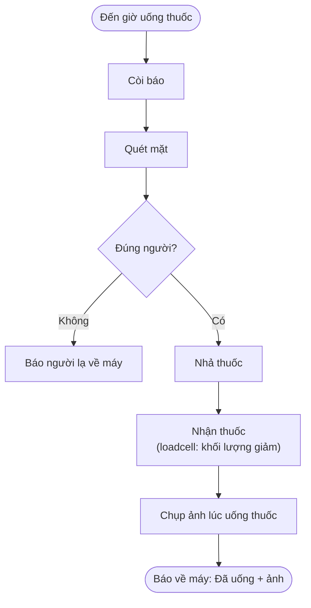

# Tủ thuốc thông minh theo dõi và nhắc nhở hành vi dùng thuốc của người bệnh

> **Smart Medicine Cabinet – Medication Reminder & Behavior Monitoring System**

| | |
|---|---|
| **Sinh viên** | Vũ Việt Anh – MSSV 23001579 |

---

## 1. Đặt bài toán

### 1.1. Nhu cầu thực tế – nguồn gốc của đề tài

Hiện nay, tình trạng già hóa dân số ngày càng gia tăng. Người cao tuổi thường mắc các bệnh mãn tính, cần sử dụng nhiều loại thuốc vào những thời điểm khác nhau mỗi ngày. Tuy nhiên, việc quên uống thuốc hoặc sử dụng sai thuốc vẫn khá phổ biến, làm giảm hiệu quả điều trị và ảnh hưởng đến sức khỏe. Trong khi đó, nhiều người trẻ phải đi làm xa, không thể thường xuyên ở bên để theo dõi và nhắc nhở cha mẹ uống thuốc đúng giờ, đúng liều lượng.

Trong gia đình có nhiều người dùng thuốc, có cả trẻ nhỏ hoặc khách đến chơi, nguy cơ lấy nhầm thuốc là có thật. Vì vậy thiết bị cần biết **ai đang đứng trước tủ**, không chỉ biết "có người lấy thuốc".

> Cảm hứng của đề tài: một thiết bị như "quản gia điện tử", đồng thời là món quà để con cái chăm sóc cha mẹ từ xa.

### 1.2. Phát biểu bài toán

Thiết kế và chế tạo một tủ thuốc thông minh giá rẻ, có thể (1) nhắc đúng giờ, (2) quét mặt nhận diện đúng người cần uống thuốc, (3) nhả đúng liều, (4) xác nhận bằng phép đo vật lý việc thuốc đã được lấy đi, (5) ghi bằng chứng bằng hình ảnh, và (6) báo cho người thân từ xa qua ứng dụng di động.

**Yêu cầu chức năng**

- Báo thức bằng còi, hiển thị trên màn hình OLED, giờ uống thuốc chỉnh từ xa trên ứng dụng.
- Nhận diện khuôn mặt bằng ESP32-CAM khi đến giờ uống thuốc, đối chiếu với khuôn mặt đã đăng ký để xác nhận **đúng người**. Nếu không khớp thì không nhả thuốc và gửi cảnh báo cho người thân.
- Nhả thuốc tự động bằng động cơ bước, mỗi ngăn một liều.
- Cân khối lượng thuốc trên đĩa cân (Loadcell + HX711) để xác định đã lấy thuốc hay chưa.
- Chụp chuỗi ảnh lúc người bệnh nhận thuốc, lưu lên đám mây làm bằng chứng.
- Ứng dụng Android: xem trạng thái "Đã uống / Chưa uống / Người lạ", khối lượng, giờ hẹn, ảnh, đăng ký khuôn mặt người bệnh, cấu hình Wi-Fi.

**Yêu cầu phi chức năng**

- Chi phí thấp, linh kiện phổ biến, mạch in tự gia công được (PCB một lớp, ăn mòn phíp đồng).
- Vẫn đúng giờ khi mất mạng hoặc mất điện đột ngột (RTC DS3231 có pin dự phòng, NVS lưu cấu hình).
- Vận hành ổn định (không treo, không brownout) khi camera, Wi-Fi và động cơ chạy cùng lúc.
- Dễ dùng cho người cao tuổi (OLED tương phản cao, chỉ cần đứng trước camera).
- Bảo mật dữ liệu khuôn mặt và ảnh (Firebase Security Rules, chỉ tài khoản người thân được xem).

---

## 2. Sơ đồ khối dự kiến

---

## 3. Các linh kiện cần mua

**Vi điều khiển, cảm biến**

| Linh kiện | Số lượng | Vai trò |
|---|---|---|
| ESP32-WROOM-32 (DevKit) | 1 | Khối Master: điều khiển trung tâm, đọc cảm biến, Firebase |
| ESP32-CAM (kèm camera OV2640) | 1 | Khối Feeder: quét mặt, chụp ảnh, điều khiển động cơ bước |
| Mạch nạp cho ESP32-CAM (ESP32-CAM-MB hoặc USB-TTL) | 1 | Nạp code cho ESP32-CAM (nên mua thêm) |
| Loadcell 1 kg (dạng thanh nhôm) | 1 | Cân khối lượng thuốc |
| Module HX711 | 1 | Khuếch đại và chuyển đổi ADC 24-bit cho loadcell |
| Module RTC DS3231 + pin CR2032 | 1 | Đồng hồ thời gian thực, giữ giờ khi mất điện, mất mạng |

**Cơ cấu chấp hành, hiển thị, báo động**

| Linh kiện | Số lượng | Vai trò |
|---|---|---|
| Động cơ bước 28BYJ-48 (5V) | 1 | Xoay khay thuốc để nhả thuốc |
| Mạch điều khiển ULN2003 | 1 | Driver cho động cơ bước |
| Màn hình OLED SSD1306 128x64 (I2C) | 1 | Hiển thị thông báo cho người bệnh |
| Còi thụ động (passive buzzer) 5V | 1 | Báo động đến giờ uống thuốc |
| Transistor 2N2222 + điện trở hạn dòng chân Base | 1 bộ | Đệm đóng ngắt còi, bảo vệ GPIO |
| Nút nhấn (TARE, CONFIRM) | 2 | Trừ bì cân, xác nhận |

**Nguồn điện**

| Linh kiện | Số lượng | Vai trò |
|---|---|---|
| Adapter 5V - 4A + jack DC | 1 | Nguồn chung cho toàn hệ thống |
| Module hạ áp AMS1117 3.3V | 1 | Cấp 3.3V cho ESP32-WROOM, HX711, DS3231 |
| Tụ hóa 470 µF | 1 | Chống sụt áp, tránh brownout cho ESP32-CAM |

**Mạch in và cơ khí**

| Linh kiện / vật tư | Số lượng | Vai trò |
|---|---|---|
| Phíp đồng một lớp + dung dịch ăn mòn | theo kích thước mạch | Gia công PCB hai khối Master và Feeder |
| Header, socket, dây jumper, thiếc hàn | 1 bộ | Lắp ráp, đấu nối |
| Nhựa PLA trắng (in 3D FDM) | 1 cuộn | Vỏ tủ, khay thuốc 8 ngăn, đĩa cân |
